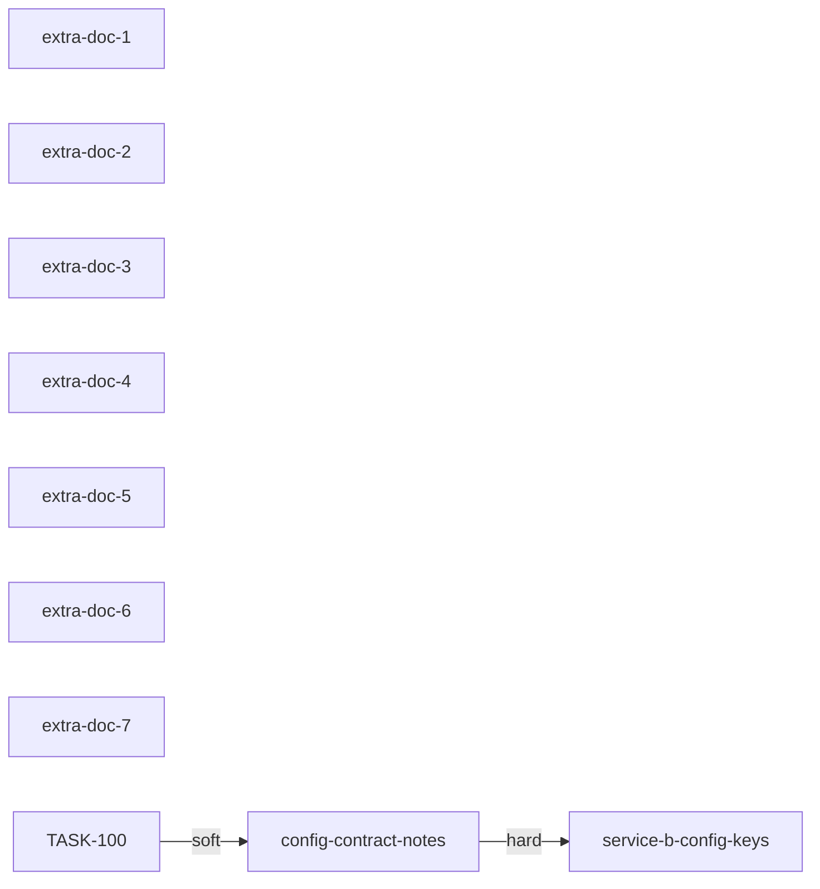

# Plan: The example services follow the shared config contract
<!-- alissa-genloop:plan v1 -->

## Why now

The shared config contract moved to 2.0 and milestone M1 of the example program is open on
exactly this: every service reads the 2.x keys. service-a's contract notes still describe 1.x and
service-b still loads the 1.x keys, so M1's first criterion stays unsatisfied until both move.

## What it serves

Milestone M1 of the example program (`b0000000000000000000000000000001`), criterion c1.

## Summary
<!-- plan-summary:begin -->
- `config-contract-notes` — service-a's contract notes describe the 2.0 config keys (example-org/service-a, doc-correction)
- `extra-doc-1` — service-a's extra config page 1 describes the 2.0 keys (example-org/service-a, doc-correction)
- `extra-doc-2` — service-a's extra config page 2 describes the 2.0 keys (example-org/service-a, doc-correction)
- `extra-doc-3` — service-a's extra config page 3 describes the 2.0 keys (example-org/service-a, doc-correction)
- `extra-doc-4` — service-a's extra config page 4 describes the 2.0 keys (example-org/service-a, doc-correction)
- `extra-doc-5` — service-a's extra config page 5 describes the 2.0 keys (example-org/service-a, doc-correction)
- `extra-doc-6` — service-a's extra config page 6 describes the 2.0 keys (example-org/service-a, doc-correction)
- `extra-doc-7` — service-a's extra config page 7 describes the 2.0 keys (example-org/service-a, doc-correction)
- `service-b-config-keys` — service-b loads the 2.0 config keys (example-org/service-b, drift-fix)
<!-- plan-summary:end -->
## Dependency graph
<!-- plan-dag:begin -->

<!-- plan-dag:end -->
## Considered and skipped

- One task for both services — skipped: two repositories, two reviews, two scopes.

## Open questions for the reviewer

- None.
